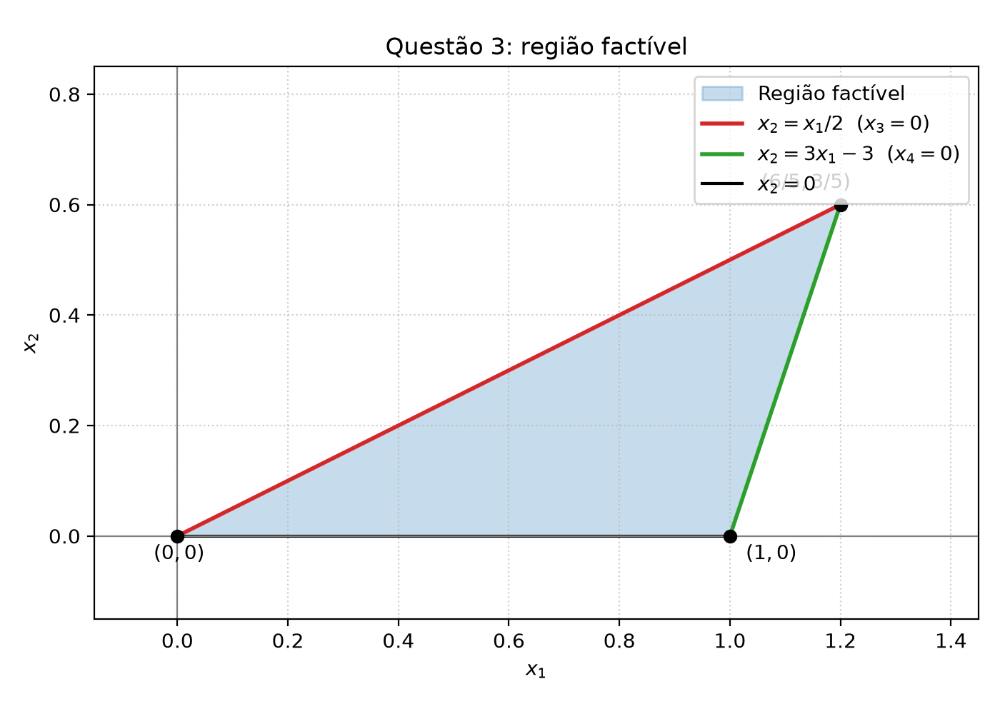

# Questão 3 — resolução

## Enunciado

$$
\begin{array}{ll}
\max & x_1 - x_2 \\
\text{s.a.} & -x_1 + 2x_2 \le 0 \\
& -3x_1 + x_2 \ge -3 \\
& x_1 \ge 0,\quad x_2 \ge 0.
\end{array}
$$

## 3a) Região factível no plano $(x_1, x_2)$

As restrições podem ser reescritas como:

$$
-x_1 + 2x_2 \le 0 \quad\Longleftrightarrow\quad x_2 \le \frac{x_1}{2},
$$

$$
-3x_1 + x_2 \ge -3 \quad\Longleftrightarrow\quad x_2 \ge 3x_1 - 3.
$$

Além disso, $x_1 \ge 0$ e $x_2 \ge 0$.

A região factível é o conjunto de pontos que satisfazem simultaneamente:

$$
x_1 \ge 0,\qquad x_2 \ge 0,\qquad
x_2 \le \frac{x_1}{2},\qquad
x_2 \ge 3x_1 - 3.
$$

Os vértices da região factível são obtidos pelas interseções das retas de fronteira:

1. $x_2 = 0$ e $x_2 = x_1/2$:

$$
(0,0).
$$

2. $x_2 = 0$ e $x_2 = 3x_1 - 3$:

$$
0 = 3x_1 - 3 \quad\Longrightarrow\quad x_1 = 1,
$$

logo, $(1,0)$.

3. $x_2 = x_1/2$ e $x_2 = 3x_1 - 3$:

$$
\frac{x_1}{2} = 3x_1 - 3
\quad\Longrightarrow\quad
x_1 = 6x_1 - 6
\quad\Longrightarrow\quad
5x_1 = 6
\quad\Longrightarrow\quad
x_1 = \frac{6}{5}.
$$

Então,

$$
x_2 = \frac{x_1}{2} = \frac{3}{5}.
$$

Logo, o terceiro vértice é

$$
\left(\frac{6}{5}, \frac{3}{5}\right).
$$

Portanto, a região factível é o triângulo de vértices

$$
(0,0),\qquad (1,0),\qquad \left(\frac{6}{5}, \frac{3}{5}\right).
$$

A figura gerada pelo código é:

## 3b) Variáveis de folga $x_3$ e $x_4$

Reescrevendo o problema na forma padrão, introduzimos as variáveis de folga $x_3, x_4 \ge 0$.

Para a primeira restrição:

$$
-x_1 + 2x_2 \le 0
\quad\Longrightarrow\quad
-x_1 + 2x_2 + x_3 = 0,
$$

com

$$
x_3 = x_1 - 2x_2.
$$

Assim,

$$
x_3 = 0 \quad\Longleftrightarrow\quad x_1 - 2x_2 = 0
\quad\Longleftrightarrow\quad
x_2 = \frac{x_1}{2}.
$$

Essa é a reta superior da fronteira da região factível. Dentro da região factível, $x_3 = 0$ ao longo do segmento que liga

$$
(0,0)\quad\text{a}\quad \left(\frac{6}{5}, \frac{3}{5}\right).
$$

Para a segunda restrição, multiplicamos por $-1$ para obter uma desigualdade $\le$:

$$
-3x_1 + x_2 \ge -3
\quad\Longleftrightarrow\quad
3x_1 - x_2 \le 3.
$$

Introduzindo $x_4 \ge 0$:

$$
3x_1 - x_2 + x_4 = 3,
$$

com

$$
x_4 = 3 - 3x_1 + x_2.
$$

Assim,

$$
x_4 = 0 \quad\Longleftrightarrow\quad 3 - 3x_1 + x_2 = 0
\quad\Longleftrightarrow\quad
x_2 = 3x_1 - 3.
$$

Essa é a reta inferior da fronteira da região factível. Dentro da região factível, $x_4 = 0$ ao longo do segmento que liga

$$
(1,0)\quad\text{a}\quad \left(\frac{6}{5}, \frac{3}{5}\right).
$$

As duas variáveis de folga são nulas simultaneamente no ponto de interseção dessas duas retas:

$$
\frac{x_1}{2} = 3x_1 - 3
\quad\Longrightarrow\quad
x_1 = \frac{6}{5},\quad x_2 = \frac{3}{5}.
$$

Portanto:

- $x_3 = 0$ na reta $x_2 = x_1/2$;
- $x_4 = 0$ na reta $x_2 = 3x_1 - 3$;
- $x_3 = x_4 = 0$ no ponto $\left(\frac{6}{5}, \frac{3}{5}\right)$.

## 3c) Solução geométrica

A função objetivo é

$$
z = x_1 - x_2.
$$

As curvas de nível são retas da forma

$$
x_1 - x_2 = k
\quad\Longleftrightarrow\quad
x_2 = x_1 - k.
$$

Para maximizar $z$, devemos deslocar essas retas o mais possível na direção de aumento de $x_1 - x_2$, isto é, para baixo e para a direita.

Avaliando a função objetivo nos vértices da região factível:

$$
(0,0):\quad z = 0 - 0 = 0,
$$

$$
(1,0):\quad z = 1 - 0 = 1,
$$

$$
\left(\frac{6}{5}, \frac{3}{5}\right):\quad
z = \frac{6}{5} - \frac{3}{5} = \frac{3}{5}.
$$

O maior valor é

$$
z^* = 1,
$$

atingido em

$$
(x_1^{*}, x_2^{*}) = (1, 0).
$$

Portanto, a solução ótima é

$$
\boxed{(x_1^{*}, x_2^{*}) = (1, 0)}
$$

com valor ótimo

$$
\boxed{z^* = 1}.
$$