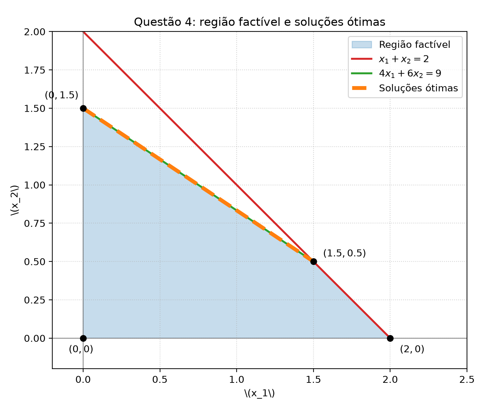

# Questão 4 — resolução

## Enunciado

$$
\begin{array}{ll}
\max & 2x_1 + 3x_2 \\
\text{s.a.} & x_1 + x_2 \le 2 \\
& 4x_1 + 6x_2 \le 9 \\
& x_1 \ge 0, \quad x_2 \ge 0.
\end{array}
$$

## 4a) Região factível no plano $(x_1, x_2)$

As restrições delimitam a região factível da seguinte forma:

1. $x_1 + x_2 \le 2 \quad\Longleftrightarrow\quad x_2 \le 2 - x_1$
2. $4x_1 + 6x_2 \le 9 \quad\Longleftrightarrow\quad x_2 \le 1.5 - \frac{2}{3}x_1$
3. $x_1 \ge 0, \quad x_2 \ge 0$

Os vértices da região factível são as interseções das fronteiras:

- Origem: $(0,0)$
- Eixo $x_1$ (fazendo $x_2 = 0$ na primeira restrição): $(2,0)$
- Eixo $x_2$ (fazendo $x_1 = 0$ na segunda restrição): $(0, 1.5)$
- Interseção das duas retas:
  $$
  \begin{cases}
  x_1 + x_2 = 2 \\
  4x_1 + 6x_2 = 9
  \end{cases}
  $$
  Multiplicando a primeira por 4:
  $$
  4x_1 + 4x_2 = 8
  $$
  Subtraindo da segunda:
  $$
  2x_2 = 1 \quad\Longrightarrow\quad x_2 = 0.5
  $$
  Logo, $x_1 = 1.5$. O vértice é $(1.5, 0.5)$.

A figura gerada pelo código ilustra essa região:

## 4b) Dois pontos extremos ótimos

A função objetivo é

$$
z = 2x_1 + 3x_2.
$$

Observe que o gradiente da função objetivo é $(2, 3)$. A segunda restrição é $4x_1 + 6x_2 \le 9$, que pode ser simplificada dividindo por 2:

$$
2x_1 + 3x_2 \le 4.5.
$$

Como a função objetivo é **paralela** à segunda restrição, as curvas de nível de $z$ coincidem com a reta $2x_1 + 3x_2 = k$. 

Para maximizar $z$, devemos deslocar essa reta o máximo possível na direção do gradiente $(2,3)$. O maior valor possível ocorre quando a reta toca a fronteira da região factível exatamente sobre a segunda restrição, no valor máximo $k = 4.5$.

Avaliando a função objetivo nos vértices:
- $(0,0)$: $z = 0$
- $(2,0)$: $z = 4$
- $(0, 1.5)$: $z = 2(0) + 3(1.5) = 4.5$
- $(1.5, 0.5)$: $z = 2(1.5) + 3(0.5) = 3 + 1.5 = 4.5$

Portanto, os dois pontos extremos ótimos são:

$$
\boxed{(x_1, x_2) = (0, 1.5)}
$$

e

$$
\boxed{(x_1, x_2) = (1.5, 0.5)}
$$

## 4c) Classe infinita de soluções ótimas

Como a função objetivo é paralela à aresta da região factível definida pela restrição $4x_1 + 6x_2 = 9$, **todo o segmento de reta** que conecta os dois vértices ótimos encontrados no item anterior é composto por soluções ótimas.

Esse segmento é definido pelos pontos $(x_1, x_2)$ tais que:

$$
4x_1 + 6x_2 = 9, \quad \text{com } 0 \le x_1 \le 1.5
$$

Ou, alternativamente, podemos escrever a solução como uma combinação convexa dos dois vértices extremos:

$$
(x_1, x_2) = \lambda(1.5, 0.5) + (1 - \lambda)(0, 1.5), \quad \text{para } \lambda \in [0, 1].
$$

Expandindo:

$$
x_1 = 1.5\lambda
$$
$$
x_2 = 0.5\lambda + 1.5(1 - \lambda) = 1.5 - \lambda
$$

Portanto, a classe infinita de soluções ótimas é:

$$
\boxed{(x_1, x_2) = (1.5\lambda, 1.5 - \lambda), \quad 0 \le \lambda \le 1}
$$

Todas essas soluções fornecem o valor ótimo máximo:

$$
z^\ast = 2(1.5\lambda) + 3(1.5 - \lambda) = 3\lambda + 4.5 - 3\lambda = 4.5
$$