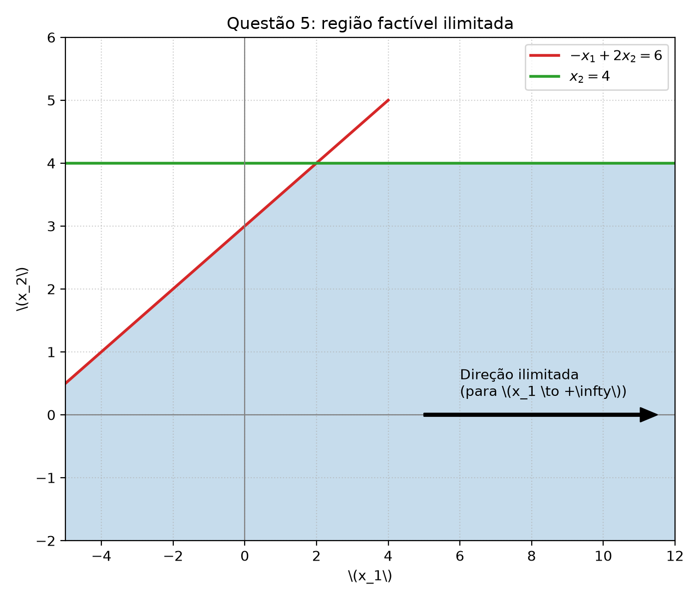

# Questão 5 — resolução

## Enunciado

$$
\begin{array}{ll}
\max & 3x_1 + x_2 \\
\text{s.a.} & -x_1 + 2x_2 \le 6 \\
& x_2 \le 4.
\end{array}
$$

## 5a) Região factível

O problema possui duas restrições:

1. $-x_1 + 2x_2 \le 6 \quad\Longleftrightarrow\quad x_1 \ge 2x_2 - 6$
2. $x_2 \le 4$

A primeira restrição define um semiplano à direita (e abaixo) da reta $x_1 = 2x_2 - 6$. A segunda restrição define um semiplano abaixo da reta horizontal $x_2 = 4$.

Como não há limites superiores para $x_1$, a região factível se estende infinitamente para a direita (para $x_1 \to +\infty$).

A figura gerada pelo código ilustra a região factível (em azul):

## 5b) Verificação de solução ótima não-limitada

Queremos **maximizar** a função objetivo:

$$
z = 3x_1 + x_2
$$

Para provar que o problema é ilimitado, precisamos encontrar uma **direção factível** na qual a função objetivo cresça infinitamente.

Vamos escolher uma semi-reta contida na região factível. Seja $x_2 = 0$ e $x_1 = t$, onde $t \ge -6$.

Verificamos as restrições para qualquer $t \ge -6$:
1. $-t + 2(0) = -t \le 6 \quad\Longrightarrow\quad t \ge -6$ (verdadeiro)
2. $0 \le 4$ (verdadeiro)

Portanto, todos os pontos da forma $(t, 0)$ com $t \ge -6$ pertencem à região factível.

Avaliando a função objetivo nesses pontos:

$$
z(t) = 3t + 0 = 3t
$$

Ao fazer $t \to +\infty$, o valor da função objetivo $z(t) \to +\infty$. Como podemos aumentar indefinidamente o valor de $x_1$ sem violar nenhuma restrição, a função objetivo crescerá sem limites.

Logo, **verifica-se que o problema tem solução ótima não-limitada**.